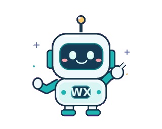

  

  <h1>Hi, I'm Wei Xiang! 👋</h1>

  

    <strong>Electrical & Electronic Engineering · Nanyang Technological University, Singapore</strong> 
    Final-year undergraduate · Graduating May 2027
  

  

    
    
    
  

  
<em>I enjoy building things that sense, move, and interact with the world — and figuring out how to make them work when conditions aren't ideal.</em>

---

## 🌱 About Me

- 🎓 Studying **Electrical and Electronic Engineering** at **NTU Singapore**.
- 🤖 Curious about how robots can **understand people and respond to their surroundings**, not just perform scripted actions.
- 🧠 Exploring **computer vision and multimodal AI**, especially how to handle imperfect or unreliable sensor data.
- ⚙️ I enjoy the hands-on side of engineering — **firmware, sensors, control systems, and plenty of debugging**.
- 🏭 Previously interned at **Micron**, working on **manufacturing automation, equipment processes, and traceability**.
- 🌱 I learn best by **building, testing, breaking, and improving** real systems.

---

## 🚀 Featured Projects

### 🤖 Multimodal Human-Robot Interaction · Final Year Project

 **Unitree G1 Humanoid Robot**

I'm developing an **RGB-D and audio perception framework** to recognize human behaviour from a humanoid robot's point of view. The main question I'm exploring is how well it works when sensing gets difficult — through **visual occlusion, background noise, distance, and different viewing angles** — and whether combining modalities can improve reliability.

`Python` `ROS1` `OpenCV` `MediaPipe` `Multimodal Perception`

### 🔬 Energy-Aware Thermal Capsule

 **Embedded Systems · Biomedical Sensing**

I'm developing **firmware for an ingestible thermal sensing prototype** built around the nRF52833. My focus is on **sensor interfacing, motion-aware sampling, low-power operation, and BLE communication**, with the goal of capturing useful measurements while managing a limited energy budget.

`Embedded C` `nRF52833` `I²C` `BLE` `Power Management`

### 👓 Portable Emotion Recognition System

 **Computer Vision · Assistive Technology**

I built a **wearable RGB and infrared vision prototype** for facial expression recognition, exploring how this technology could support people with visual impairments. This project brought together **deep learning, image processing, and Raspberry Pi hardware** in a working prototype.

`Python` `PyTorch` `TensorFlow/Keras` `Raspberry Pi`

---

## 🛠️ My Tech Stack

**💻 Programming**

**🤖 Robotics & Simulation**

**🧠 Computer Vision & AI**

**⚙️ Embedded Systems & Control**

**🔧 Development Tools**

---

## 🔭 Currently Exploring

- 🦾 **Embodied AI:** Leading a six-person team preparing for the **Singapore Embodied AI Challenge**.
- 🧠 **Robot Learning:** Learning about vision-language-action models and how perception connects to robotic decision-making.

---

## 🌍 Professional Interests

I'm drawn to **robotics and intelligent sensing** for **healthcare, assistive technology, and industrial automation**. Long term, I hope to help turn promising prototypes into systems people can actually depend on outside a controlled lab.

  

